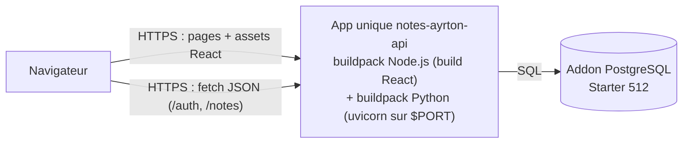

# Notes — React + FastAPI + PostgreSQL sur Scalingo

Application de prise de notes avec comptes utilisateurs, déployée sur Scalingo en HTTPS.

| | URL |
|---|---|
| 🌐 Application (client React) | https://notes-ayrton-api.osc-fr1.scalingo.io |
| ⚙️ API | même domaine — doc Swagger sur [`/docs`](https://notes-ayrton-api.osc-fr1.scalingo.io/docs), santé sur [`/health`](https://notes-ayrton-api.osc-fr1.scalingo.io/health) |


---

## 1. Architecture — variante « une seule app » (justification)



Le sujet accepte cette variante : **l'API sert elle-même le build React**. Choix retenu parce que :
1. **Contrainte de compte** : en période d'essai, Scalingo n'autorise qu'**une seule application** (« You cannot create more apps while in free trial ») ; sortir de l'essai impose de saisir un profil de facturation, ce que nous n'avons pas fait sur consigne de l'enseignant.
2. **Coût** : un seul conteneur S au lieu de deux → 14,40 € HT/mois au lieu de 21,60 €.
3. **Sécurité** : client et API sur la **même origine** → aucun appel cross-origin ; le CORS reste configuré (restreint à cette origine) mais n'est plus sollicité.

Fonctionnement :
- `.buildpacks` (racine) enchaîne **Node.js puis Python** ; le dernier listé (Python) démarre l'app.
- Le buildpack Node.js lance le script `build` du `package.json` racine → `client/dist`.
- Le buildpack Python installe `requirements.txt` (racine, qui inclut `api/requirements.txt`) ; le `Procfile` racine lance uvicorn depuis `api/`.
- FastAPI sert `client/dist` : `/assets/*` en statique, et toute autre URL inconnue renvoie `index.html` (routage côté client, pas de 404 au rafraîchissement). Les routes de l'API sont déclarées avant et restent prioritaires.
- Pour éviter les collisions, les pages React utilisent `/connexion`, `/inscription`, `/mes-notes` (l'API garde `/auth/*`, `/notes`, `/health`, `/docs`).
- Le mode « deux apps » reste possible sans changer le code : `PROJECT_DIR=api` d'un côté (`api/Procfile`), `PROJECT_DIR=client` de l'autre (`npm start` = `serve -s dist`).
- **Pas de disque** : le conteneur est éphémère, toutes les données sont dans PostgreSQL. SQLite est refusé au démarrage.
- **Schéma** géré par Alembic : `postdeploy: alembic upgrade head` rejoue les migrations après chaque déploiement (aucun `create_all`).
- **Auth** : inscription / connexion, mot de passe haché (bcrypt), jeton JWT signé avec `JWT_SECRET`.

```
.
├── api/                      # FastAPI
│   ├── app/                  # config (pydantic-settings), modèles, routes, sécurité
│   ├── migrations/           # Alembic (migrations versionnées)
│   ├── tests/                # pytest sur un vrai PostgreSQL
│   ├── Procfile              # web + postdeploy
│   ├── .python-version       # 3.13
│   ├── requirements.txt      # dépendances figées
│   ├── seed.py               # données initiales (lancé une fois)
│   └── .env.example
├── client/                   # React + TypeScript + Vite
│   ├── src/
│   ├── public/serve.json     # cache des assets
│   └── .env.example
├── .github/workflows/        # CI : api.yml, client.yml (déclenchées par dossier)
├── .buildpacks               # Node.js puis Python (variante une seule app)
├── Procfile                  # web + postdeploy (lancés depuis api/)
├── package.json              # script build → client/dist
├── requirements.txt          # -r api/requirements.txt
├── .python-version
└── docker-compose.yml        # PostgreSQL local
```

---

## 2. Lancer en local (sans rien demander à personne)

Prérequis : Docker, Python 3.13, Node 22.

```bash
git clone <url-du-depot> && cd <depot>
docker compose up -d                     # PostgreSQL 16 (bases notes + notes_test)

# API
cd api
cp .env.example .env                     # puis mettre une vraie valeur dans JWT_SECRET
python -m venv .venv && source .venv/bin/activate
pip install -r requirements.txt -r requirements-dev.txt
alembic upgrade head
SEED_PASSWORD=demo12345 python seed.py   # optionnel : compte demo@example.com
uvicorn app.main:app --reload            # http://localhost:8000/docs
pytest                                   # tests sur notes_test

# Client (autre terminal)
cd client
cp .env.example .env
npm install
npm run dev                              # http://localhost:5173
```

---

## 3. Déploiement sur Scalingo (procédure reproductible)

### 3.0 Prérequis (une seule fois)
1. Voucher Ynov récupéré sur `partners.learn.ynov.com`, compte Scalingo créé, voucher activé dans **Billing → Voucher** (mettre fin à la période d'essai pour l'activer).
2. CLI installée : `curl -O https://cli-dl.scalingo.com/install && bash install`, puis `scalingo login` et `scalingo keys-add "Mon PC" ~/.ssh/id_ed25519.pub`.
3. Dépôt poussé sur GitHub.

### 3.1 Application unique + base
```bash
APP=notes-ayrton-api

scalingo create $APP --region osc-fr1
scalingo --app $APP addons-add postgresql postgresql-starter-512
scalingo --app $APP env-set \
  JWT_SECRET="$(python3 -c 'import secrets; print(secrets.token_urlsafe(48))')" \
  VITE_API_URL=https://$APP.osc-fr1.scalingo.io \
  CORS_ORIGINS=https://$APP.osc-fr1.scalingo.io
```
⚠️ **Pas de `PROJECT_DIR`** : le build part de la racine (`.buildpacks`). `VITE_API_URL` doit exister **avant** le build (Vite la fige dans le bundle).

Lier au dépôt GitHub (dashboard → **Deploy → Configuration → GitHub**, branche `main`, **Automatic deploys** activé), puis **Manual deployment** pour le premier déploiement. Ensuite :
```bash
scalingo --app $APP scale web:1:S          # Scalingo crée le conteneur en M par défaut
scalingo --app $APP run --env SEED_PASSWORD='<mot-de-passe-demo>' python api/seed.py   # une seule fois
```
Vérifications : `https://$APP.osc-fr1.scalingo.io/health` → `{"status":"ok","database":"up"}` ; `/docs` → Swagger ; `/mes-notes` rafraîchi → page React (pas de 404).

### 3.3 Déploiement continu
- Un `push` sur `main` déploie automatiquement l'app concernée.
- Les GitHub Actions (`api.yml`, `client.yml`) ne se lancent que sur le dossier modifié (`paths:`).
- Scalingo attend que les checks GitHub soient **verts** avant de déployer : une PR qui casse un test n'atteint jamais la prod.
- Pour aller plus loin : activer les **Review Apps** (une app temporaire par pull request).

---

## 4. Variables d'environnement

| App | Variable | Rôle |
|---|---|---|
| API | `SCALINGO_POSTGRESQL_URL` | Fournie automatiquement par l'addon (`postgres://` converti en `postgresql+psycopg://` par le code) |
| API | `DATABASE_URL` | Utilisée en local uniquement (même rôle) |
| API | `JWT_SECRET` | Clé de signature des jetons (≥ 32 caractères, aléatoire) |
| API | `JWT_EXPIRE_MINUTES` | Durée de validité du jeton (défaut 60) |
| API | `CORS_ORIGINS` | URL publique du client (ici la même que l'API) |
| API | `VITE_API_URL` | URL publique de l'API, lue au **build** du client (ici la même app) |
| API | `SEED_EMAIL` / `SEED_PASSWORD` | Compte démo créé par `seed.py` (passé à `scalingo run --env`) |
| API | `PORT` | Fourni par Scalingo |
| _(mode 2 apps)_ | `PROJECT_DIR` | `api` ou `client` — inutile en variante une seule app |

Aucune valeur secrète n'est dans Git : seuls les `.env.example` sont versionnés.

---

## 5. Coûts

Tarifs Scalingo, région standard `osc-fr1`, base 30 jours, HT :

| Ressource | Taille | Estimation / mois |
|---|---|---|
| App unique (client + API) | 1 conteneur S (256 Mo) | 7,20 € |
| PostgreSQL | Starter 512 (512 Mo, 10 Go) | 7,20 € |
| **Total** | | **14,40 € HT ≈ 17,28 € TTC** |

(La variante à deux apps coûterait 21,60 € HT : un conteneur S de plus.)

✅ Sous le plafond du voucher Ynov (50 €/mois, 450 €/an). ⚠️ Le compte est encore en **période d'essai** (gratuite, 30 jours) : le voucher ne s'active qu'à la fin de l'essai.

| Période | Consommation réelle (Billing) | Écart vs estimation |
|---|---|---|
| Semaine 1 | _à compléter_ | |
| Semaine 2 | _à compléter_ | |
| Fin de module | _à compléter_ | |

**Fin de module** : `scalingo --app <app> scale web:0` (ou suppression des apps + addon) pour arrêter la facturation.

---

## 6. En cas de panne

### Lire les logs
```bash
scalingo --app $API logs --lines 200            # API (inclut le postdeploy / Alembic)
scalingo --app $API logs -f                     # en continu
scalingo --app $API addons                      # récupérer l'ID de l'addon PostgreSQL
scalingo --app $API --addon <addon-id> logs --lines 200   # logs de la base
scalingo --app $API deployments                 # historique des déploiements
```

**Erreur provoquée volontairement (exercice)** : `scalingo --app $API env-set JWT_SECRET=trop-court`
→ symptôme : l'app ne démarre plus (le site renvoie une erreur Scalingo) ;
→ diagnostic : `scalingo --app $API logs --lines 200` montre une `ValidationError` pydantic sur `jwt_secret` (32 caractères minimum) ;
→ correction : remettre un secret valide avec `env-set` (redémarrage automatique). Les sessions ouvertes sont invalidées, il faut se reconnecter.

### Revenir à une version précédente (rollback)
Le déploiement suit Git, donc le rollback passe par Git :
```bash
git log --oneline                    # repérer le commit fautif
git revert <sha-fautif>              # crée un commit qui annule le changement
git push origin main                 # CI verte → redéploiement automatique
```
Alternative immédiate (sans attendre la CI) : dashboard → **Deploy → Manual deploy** d'une branche pointant sur le dernier commit sain.

⚠️ Si la version fautive contenait une migration, la défaire d'abord : `scalingo --app $API run alembic downgrade -1`.

### Sauvegarder la base
Les sauvegardes automatiques sont incluses dans l'addon (onglet **Backups** du dashboard de la base).
```bash
scalingo --app $API --addon postgresql backups               # lister
scalingo --app $API --addon postgresql backups-download      # télécharger la dernière (.tar.gz)
scalingo --app $API --addon postgresql backups-download --backup <id>   # une sauvegarde précise
```
Sauvegarde manuelle avant une migration risquée : dashboard de la base → **Backups** → déclencher une sauvegarde.

### Restaurer la base
```bash
tar -xzf <backup>.tar.gz                                     # → fichier .pgsql
scalingo --app $API db-tunnel SCALINGO_POSTGRESQL_URL        # terminal 1 : tunnel sur localhost:10000
# terminal 2 : reprendre user/mot de passe/nom de base de `scalingo --app $API env | grep SCALINGO_POSTGRESQL_URL`
pg_restore --clean --if-exists --no-owner --no-privileges --no-comments \
  --dbname "postgresql://<user>:<password>@127.0.0.1:10000/<db>" <fichier>.pgsql
```

### Métriques
Onglet **Metrics** de chaque app (mémoire et CPU), ou `scalingo --app $API stats --stream`. Si la mémoire reste sous ~70 % des 256 Mo, la taille S suffit.

### Problèmes fréquents
| Symptôme | Cause probable | Solution |
|---|---|---|
| Build : `requirements.txt not found` | `PROJECT_DIR` défini par erreur, ou `requirements.txt` racine absent | Supprimer `PROJECT_DIR` (variante une seule app) |
| `/health` → 503 | Base injoignable | Vérifier l'addon et `SCALINGO_POSTGRESQL_URL` |
| `relation "users" does not exist` | Migrations non jouées | Vérifier le process `postdeploy` dans les logs ; `scalingo run alembic upgrade head` |
| Client appelle `localhost` | `VITE_API_URL` définie après le build | La définir puis redéployer |
| `/mes-notes` renvoie du JSON ou 404 | `client/dist` absent : build Node.js non exécuté | Vérifier `.buildpacks` et les logs de build |
| Erreur CORS | `CORS_ORIGINS` ≠ URL du client | Corriger (sans `/` final) |
| Boot timeout | Process qui n'écoute pas sur `$PORT` | Vérifier le `Procfile` / le script `start` |
