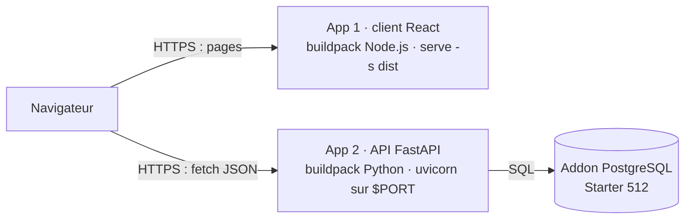

# Notes — React + FastAPI + PostgreSQL sur Scalingo

Application de prise de notes avec comptes utilisateurs, déployée sur Scalingo en HTTPS.

| | URL |
|---|---|
| 🌐 Client | `https://<app-client>.osc-fr1.scalingo.io` |
| ⚙️ API | `https://<app-api>.osc-fr1.scalingo.io` — doc Swagger sur `/docs`, santé sur `/health` |

> Remplacer `<app-client>` / `<app-api>` par les noms de vos apps (ex. `notes-ayrton-client`, `notes-ayrton-api`).

---

## 1. Architecture



- **Monorepo** : `client/` et `api/` dans le même dépôt ; chaque app Scalingo pointe sur son dossier via `PROJECT_DIR`.
- Le navigateur charge le client (app 1) puis appelle **directement** l'API (app 2). Seule l'API parle à la base.
- **CORS** : l'API n'accepte que l'origine du client (`CORS_ORIGINS`), jamais `*`.
- **Pas de disque** : le conteneur est éphémère, toutes les données sont dans PostgreSQL. SQLite est refusé au démarrage.
- **Schéma** géré par Alembic : `postdeploy: alembic upgrade head` rejoue les migrations après chaque déploiement (aucun `create_all`).
- **Auth** : inscription / connexion, mot de passe haché (bcrypt), jeton JWT signé avec `JWT_SECRET`.

```
.
├── api/                      # FastAPI
│   ├── app/                  # config (pydantic-settings), modèles, routes, sécurité
│   ├── migrations/           # Alembic (migrations versionnées)
│   ├── tests/                # pytest sur un vrai PostgreSQL
│   ├── Procfile              # web + postdeploy
│   ├── .python-version       # 3.13
│   ├── requirements.txt      # dépendances figées
│   ├── seed.py               # données initiales (lancé une fois)
│   └── .env.example
├── client/                   # React + TypeScript + Vite
│   ├── src/
│   ├── public/serve.json     # cache des assets
│   └── .env.example
├── .github/workflows/        # CI : api.yml, client.yml (déclenchées par dossier)
└── docker-compose.yml        # PostgreSQL local
```

---

## 2. Lancer en local (sans rien demander à personne)

Prérequis : Docker, Python 3.13, Node 22.

```bash
git clone <url-du-depot> && cd <depot>
docker compose up -d                     # PostgreSQL 16 (bases notes + notes_test)

# API
cd api
cp .env.example .env                     # puis mettre une vraie valeur dans JWT_SECRET
python -m venv .venv && source .venv/bin/activate
pip install -r requirements.txt -r requirements-dev.txt
alembic upgrade head
SEED_PASSWORD=demo12345 python seed.py   # optionnel : compte demo@example.com
uvicorn app.main:app --reload            # http://localhost:8000/docs
pytest                                   # tests sur notes_test

# Client (autre terminal)
cd client
cp .env.example .env
npm install
npm run dev                              # http://localhost:5173
```

---

## 3. Déploiement sur Scalingo (procédure reproductible)

### 3.0 Prérequis (une seule fois)
1. Voucher Ynov récupéré sur `partners.learn.ynov.com`, compte Scalingo créé, voucher activé dans **Billing → Voucher** (mettre fin à la période d'essai pour l'activer).
2. CLI installée : `curl -O https://cli-dl.scalingo.com/install && bash install`, puis `scalingo login` et `scalingo keys-add "Mon PC" ~/.ssh/id_ed25519.pub`.
3. Dépôt poussé sur GitHub.

### 3.1 API + base
```bash
API=notes-ayrton-api
CLIENT=notes-ayrton-client

scalingo create $API --region osc-fr1
scalingo --app $API addons-add postgresql postgresql-starter-512
scalingo --app $API env-set \
  PROJECT_DIR=api \
  JWT_SECRET="$(python3 -c 'import secrets; print(secrets.token_urlsafe(48))')" \
  CORS_ORIGINS=https://$CLIENT.osc-fr1.scalingo.io
```
Lier au dépôt GitHub (dashboard → **Deploy → GitHub**, branche `main`, **Auto Deploy** activé), puis lancer le premier déploiement. Ensuite :
```bash
scalingo --app $API scale web:1:S
scalingo --app $API run --env SEED_PASSWORD='<mot-de-passe-demo>' python seed.py   # une seule fois
curl https://$API.osc-fr1.scalingo.io/health   # → {"status":"ok","database":"up"}
```

### 3.2 Client
```bash
scalingo create $CLIENT --region osc-fr1
scalingo --app $CLIENT env-set \
  PROJECT_DIR=client \
  VITE_API_URL=https://$API.osc-fr1.scalingo.io     # AVANT le déploiement : figée au build
```
Lier au même dépôt (branche `main`, Auto Deploy), déployer, puis `scalingo --app $CLIENT scale web:1:S`.

Scalingo exécute `npm run build` puis `npm start` (`serve -s dist` sur `$PORT`). Le mode `-s` renvoie `index.html` pour toute URL inconnue : rafraîchir `/notes` ne donne pas de 404.

> ⚠️ Changer `VITE_API_URL` impose un **redéploiement** du client (la valeur est gravée dans le bundle).

### 3.3 Déploiement continu
- Un `push` sur `main` déploie automatiquement l'app concernée.
- Les GitHub Actions (`api.yml`, `client.yml`) ne se lancent que sur le dossier modifié (`paths:`).
- Scalingo attend que les checks GitHub soient **verts** avant de déployer : une PR qui casse un test n'atteint jamais la prod.
- Pour aller plus loin : activer les **Review Apps** (une app temporaire par pull request).

---

## 4. Variables d'environnement

| App | Variable | Rôle |
|---|---|---|
| API | `PROJECT_DIR` | `api` — dossier de l'app dans le monorepo |
| API | `SCALINGO_POSTGRESQL_URL` | Fournie automatiquement par l'addon (`postgres://` converti en `postgresql+psycopg://` par le code) |
| API | `DATABASE_URL` | Utilisée en local uniquement (même rôle) |
| API | `JWT_SECRET` | Clé de signature des jetons (≥ 32 caractères, aléatoire) |
| API | `JWT_EXPIRE_MINUTES` | Durée de validité du jeton (défaut 60) |
| API | `CORS_ORIGINS` | URL(s) publique(s) du client, séparées par des virgules |
| API | `SEED_EMAIL` / `SEED_PASSWORD` | Compte démo créé par `seed.py` (passé à `scalingo run --env`) |
| API | `PORT` | Fourni par Scalingo |
| Client | `PROJECT_DIR` | `client` |
| Client | `VITE_API_URL` | URL publique de l'API (figée au build) |
| Client | `PORT` | Fourni par Scalingo |

Aucune valeur secrète n'est dans Git : seuls les `.env.example` sont versionnés.

---

## 5. Coûts

Tarifs Scalingo, région standard `osc-fr1`, base 30 jours, HT :

| Ressource | Taille | Estimation / mois |
|---|---|---|
| App client | 1 conteneur S (256 Mo) | 7,20 € |
| App API | 1 conteneur S (256 Mo) | 7,20 € |
| PostgreSQL | Starter 512 (512 Mo, 10 Go) | 7,20 € |
| **Total** | | **21,60 € HT ≈ 25,92 € TTC** |

✅ Sous le plafond du voucher Ynov (50 €/mois, 450 €/an).

| Période | Consommation réelle (Billing) | Écart vs estimation |
|---|---|---|
| Semaine 1 | _à compléter_ | |
| Semaine 2 | _à compléter_ | |
| Fin de module | _à compléter_ | |

**Fin de module** : `scalingo --app <app> scale web:0` sur les deux apps (ou suppression des apps + addon) pour arrêter la facturation.

---

## 6. En cas de panne

### Lire les logs
```bash
scalingo --app $API logs --lines 200            # API (inclut le postdeploy / Alembic)
scalingo --app $API logs -f                     # en continu
scalingo --app $CLIENT logs --lines 200         # client
scalingo --app $API addons                      # récupérer l'ID de l'addon PostgreSQL
scalingo --app $API --addon <addon-id> logs --lines 200   # logs de la base
scalingo --app $API deployments                 # historique des déploiements
```

**Erreur provoquée volontairement (exercice)** : `scalingo --app $API env-set CORS_ORIGINS=https://mauvaise-url.example`
→ symptôme : le client affiche « Failed to fetch » et l'onglet Réseau montre une erreur CORS ;
→ diagnostic : `curl -I -X OPTIONS https://$API.osc-fr1.scalingo.io/notes -H "Origin: https://$CLIENT.osc-fr1.scalingo.io" -H "Access-Control-Request-Method: GET"` ne renvoie pas d'en-tête `access-control-allow-origin` ;
→ correction : remettre la bonne valeur avec `env-set` (redémarrage automatique).

### Revenir à une version précédente (rollback)
Le déploiement suit Git, donc le rollback passe par Git :
```bash
git log --oneline                    # repérer le commit fautif
git revert <sha-fautif>              # crée un commit qui annule le changement
git push origin main                 # CI verte → redéploiement automatique
```
Alternative immédiate (sans attendre la CI) : dashboard → **Deploy → Manual deploy** d'une branche pointant sur le dernier commit sain.

⚠️ Si la version fautive contenait une migration, la défaire d'abord : `scalingo --app $API run alembic downgrade -1`.

### Sauvegarder la base
Les sauvegardes automatiques sont incluses dans l'addon (onglet **Backups** du dashboard de la base).
```bash
scalingo --app $API --addon postgresql backups               # lister
scalingo --app $API --addon postgresql backups-download      # télécharger la dernière (.tar.gz)
scalingo --app $API --addon postgresql backups-download --backup <id>   # une sauvegarde précise
```
Sauvegarde manuelle avant une migration risquée : dashboard de la base → **Backups** → déclencher une sauvegarde.

### Restaurer la base
```bash
tar -xzf <backup>.tar.gz                                     # → fichier .pgsql
scalingo --app $API db-tunnel SCALINGO_POSTGRESQL_URL        # terminal 1 : tunnel sur localhost:10000
# terminal 2 : reprendre user/mot de passe/nom de base de `scalingo --app $API env | grep SCALINGO_POSTGRESQL_URL`
pg_restore --clean --if-exists --no-owner --no-privileges --no-comments \
  --dbname "postgresql://<user>:<password>@127.0.0.1:10000/<db>" <fichier>.pgsql
```

### Métriques
Onglet **Metrics** de chaque app (mémoire et CPU), ou `scalingo --app $API stats --stream`. Si la mémoire reste sous ~70 % des 256 Mo, la taille S suffit.

### Problèmes fréquents
| Symptôme | Cause probable | Solution |
|---|---|---|
| Build API : `requirements.txt not found` | `PROJECT_DIR` absent | `env-set PROJECT_DIR=api` |
| `/health` → 503 | Base injoignable | Vérifier l'addon et `SCALINGO_POSTGRESQL_URL` |
| `relation "users" does not exist` | Migrations non jouées | Vérifier le process `postdeploy` dans les logs ; `scalingo run alembic upgrade head` |
| Client appelle `localhost` | `VITE_API_URL` définie après le build | La définir puis redéployer |
| Erreur CORS | `CORS_ORIGINS` ≠ URL du client | Corriger (sans `/` final) |
| Boot timeout | Process qui n'écoute pas sur `$PORT` | Vérifier le `Procfile` / le script `start` |
